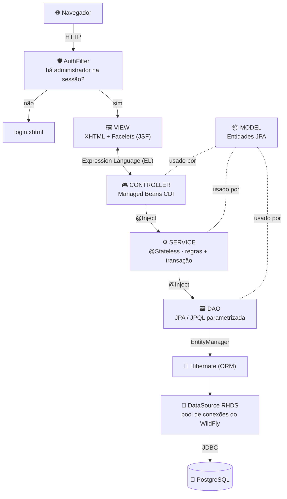
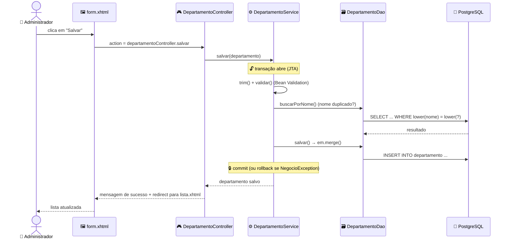
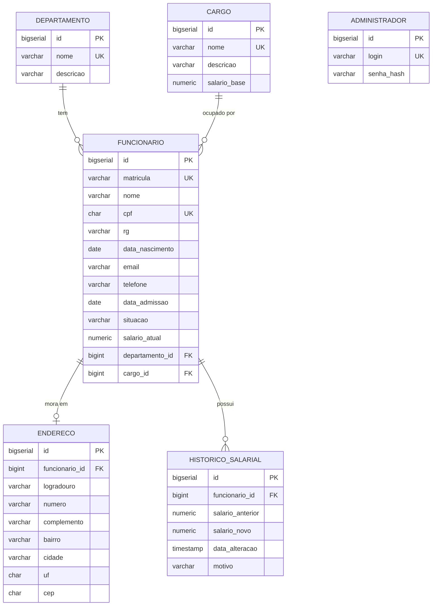

<div align="center">

# 👥 Sistema de Gestão de Funcionários (RH)

Aplicação web corporativa para o departamento de Recursos Humanos gerenciar **funcionários, departamentos, cargos e salários**, construída com a stack clássica **Java EE 7** em arquitetura **MVC em camadas**.


</div>

---


## 🧰 Tecnologias

| Tecnologia | Versão | Papel no projeto |
|---|---|---|
| ☕ **Java** (Oracle JDK) | 1.8 | Linguagem de programação |
| 🐘 **Gradle** | Wrapper incluso | Dependências, compilação e geração do `.war` |
| 🖥️ **JSF** (Mojarra) + **Facelets** | 2.2 | Camada web (páginas `.xhtml`) |
| 💉 **CDI** | 1.2 | Injeção de dependências e *scopes* dos Controllers |
| 🫘 **EJB** (`@Stateless`) | 3.2 | Services e DAOs, com transações gerenciadas (JTA) |
| 🧩 **JPA** | 2.1 | Especificação de persistência |
| 🐝 **Hibernate** | 5.0.10 | Implementação do JPA (ORM) |
| ✅ **Bean Validation** | 1.1 | Validação de formato nas entidades |
| 🐘 **PostgreSQL** | 12 ou superior | Banco de dados relacional |
| 🔌 **Driver JDBC PostgreSQL** | 42.2.x | Instalado como módulo no WildFly |
| 🔴 **WildFly** | 10.1.0.Final | Servidor de aplicação (Java EE 7) |
| 🔒 **jBCrypt** | 0.4 | Hash de senhas |
| 🎨 **HTML + CSS** | — | Interface responsiva, sem frameworks externos |


> **Por que não Spring Boot?** O objetivo é aprender a stack Java EE clássica. Tudo que o projeto usa (JSF, CDI, EJB, JPA, Bean Validation) **já vem dentro do WildFly**, então o `.war` leva apenas o código da aplicação e o jBCrypt.

---

## ✨ Funcionalidades

### 🔑 Autenticação
- Tela de login com senha protegida por **BCrypt**
- Um único usuário: o **administrador**
- Controle de sessão (expira em 30 minutos sem uso) e **logout**
- Troca de senha pelo próprio sistema
- Todas as páginas internas protegidas por filtro

### 👤 Funcionários
- Cadastrar, listar, **consultar por ID** (tela de detalhes), editar
- **Inativar e reativar** (nunca exclui, para preservar o histórico)
- **Busca** por nome, CPF (com ou sem pontuação) ou matrícula
- Dados pessoais, dados profissionais e **endereço** na mesma tela
- Validação de **CPF** (dígitos verificadores), CPF e matrícula únicos, datas coerentes
- Máscara/normalização de CPF e CEP

### 🏢 Departamentos
- Cadastrar, listar, editar e excluir
- Nome único (sem diferenciar maiúsculas de minúsculas)
- **Bloqueia a exclusão** se houver funcionários vinculados

### 💼 Cargos e salários
- Cadastrar cargos com descrição e **salário-base**
- Associar cargos aos funcionários (o salário-base é sugerido no cadastro)
- **Atualização salarial** com motivo obrigatório
- **Histórico salarial** completo: salário anterior, novo, data e motivo
- Bloqueia a exclusão de cargo com funcionários vinculados

---

## 🏛️ Arquitetura

O sistema segue o padrão **MVC dividido em camadas**. Cada camada só conhece a imediatamente abaixo:

```
Controller  →  Service  →  DAO  →  Banco
```



### O que cada camada faz

| Camada | Tecnologia | Responsabilidade | O que **não** faz |
|---|---|---|---|
| 🖼️ **View** | XHTML + Facelets | Exibir dados e capturar cliques/formulários | Regra de negócio |
| 🎮 **Controller** | CDI `@Named` + `@ViewScoped` | Receber a ação da tela, chamar o Service, mostrar mensagens e escolher a navegação | Acessar o banco, validar regras |
| ⚙️ **Service** | EJB `@Stateless` | **Regras de negócio**, validações e **fronteira transacional** | Conhecer o JSF |
| 🗃️ **DAO** | JPA `EntityManager` + JPQL | Consultas e persistência | Regras de negócio |
| 📦 **Model** | Entidades JPA | Mapear tabelas e relacionamentos | Lógica de tela |
| 🧱 **Persistence** | `persistence.xml` + DataSource | Ligar JPA/Hibernate ao PostgreSQL | — |
| 🛡️ **Security** | `AuthFilter` + `SessaoAdmin` | Barrar acessos sem login | — |
| 🔄 **Converter** | JSF `Converter` | Traduzir texto da tela ↔ objeto Java (CPF, departamento, cargo) | — |
| 🧰 **Util / Exception** | Java puro | CPF, BCrypt, mensagens JSF, `NegocioException` | — |

### Por que cada decisão

- **Service dono da transação:** uma operação como "reajustar salário" grava o histórico **e** atualiza o funcionário. Com `@Stateless`, o contêiner abre a transação ao entrar no método e faz *commit* ou *rollback* ao sair, então nunca fica gravado pela metade.
- **`@ViewScoped` nos Controllers:** o estado do formulário sobrevive enquanto o usuário está na página, sem inflar a sessão.
- **`NegocioException` com `@ApplicationException(rollback = true)`:** chega intacta ao Controller (que mostra a mensagem ao usuário) e desfaz a transação.
- **Validação em duas linhas:** formato nas entidades (Bean Validation), regras no Service, e **constraints no banco** como última defesa contra acesso concorrente.
- **Hibernate com `hbm2ddl.auto=none`:** quem manda no esquema do banco são os scripts SQL, não o ORM.

---

## 🔌 Como front-end, back-end e banco se conectam

### 1️⃣ Front-end ↔ Back-end (JSF)

As páginas `.xhtml` não têm lógica. Elas se ligam aos Controllers por **Expression Language (EL)**:

```xml
<!-- funcionario/lista.xhtml -->
<h:inputText value="#{funcionarioController.termoBusca}"/>
<h:commandButton value="Pesquisar" action="#{funcionarioController.pesquisar}"/>
```

- `value="#{...}"` liga o campo a um **atributo** do Controller (getter/setter).
- `action="#{...}"` liga o botão a um **método** do Controller.
- O `FacesServlet` (mapeado para `*.xhtml` no `web.xml`) intercepta a requisição e executa o ciclo de vida do JSF: ler os valores, **converter**, validar, atribuir ao bean, chamar a ação e desenhar a resposta.
- O `layout.xhtml` é um **template** único (cabeçalho, menu, mensagens, rodapé); cada página só preenche o conteúdo.
- Botões usam **AJAX** (`<f:ajax>`) quando faz sentido, por exemplo sugerir o salário ao escolher o cargo.
- Após salvar, o Controller responde com **redirect** (`lista?faces-redirect=true`), o padrão *Post/Redirect/Get*, que impede duplicar registros ao apertar F5.

### 2️⃣ Back-end: Controller → Service → DAO

Tudo é ligado por **injeção de dependências (CDI)**, sem nenhum `new`:

```java
@Named @ViewScoped
public class DepartamentoController implements Serializable {
    @Inject private DepartamentoService departamentoService;   // Controller → Service
    ...
}

@Stateless
public class DepartamentoService extends BaseService {
    @Inject private DepartamentoDao departamentoDao;           // Service → DAO
    ...
}

@Stateless
public class DepartamentoDao extends GenericDao<Departamento> { ... }
```

### 3️⃣ Back-end ↔ Banco (JPA/Hibernate + DataSource)

```
DAO ──▶ EntityManager (JPA) ──▶ Hibernate (gera o SQL) ──▶ DataSource ──▶ driver JDBC ──▶ PostgreSQL
```

1. O DAO recebe o `EntityManager` do servidor: `@PersistenceContext(unitName = "rhPU")`.
2. O **`persistence.xml`** define a unidade `rhPU` e aponta para o DataSource `java:jboss/datasources/RHDS`.
3. O **DataSource** é configurado **no WildFly** (URL, usuário, senha e *pool* de conexões). **A senha do banco nunca aparece no código nem no `.war`.**
4. O Hibernate lê as anotações das entidades (`@Entity`, `@Column`, `@ManyToOne`...) e traduz objetos em SQL.
5. O driver JDBC (módulo `org.postgresql` do WildFly) fala com o PostgreSQL.

### 🔁 Fluxo completo: salvar um departamento



---

## 🔐 Segurança

| Recurso | Como funciona |
|---|---|
| 🔒 **Senha com BCrypt** | O banco guarda apenas o hash (`$2a$10$...`), nunca a senha |
| 🛡️ **`AuthFilter`** | Executa antes de **toda** requisição. Sem administrador na sessão, redireciona para `/login.xhtml`. Só o login e os recursos estáticos são públicos |
| 🪪 **`SessaoAdmin`** | Bean `@SessionScoped` que guarda só `id` e `login` do administrador logado |
| 🔄 **Sessão renovada no login** | `changeSessionId()` evita *session fixation* |
| 🕵️ **Mensagem genérica** | "Login ou senha inválidos", sem revelar qual estava errado; o tempo de resposta também é igualado |
| 🚪 **Logout** | Invalida a sessão inteira |
| 🧯 **Sem cache após sair** | Cabeçalhos `no-store` impedem o botão "Voltar" de mostrar páginas protegidas |
| 💉 **Anti SQL Injection** | Todas as consultas usam parâmetros nomeados (`:nome` + `setParameter`) |
| ✅ **Validação no back-end** | O Service valida de novo, independente da tela |

---

## 🗄️ Banco de dados

### Modelo (DER)



### Decisões de modelagem

- 💰 Dinheiro em `NUMERIC(12,2)` / `BigDecimal` (sem erro de arredondamento do `double`).
- 📜 `funcionario.salario_atual` guarda o valor corrente; `historico_salarial` guarda cada mudança. As duas gravações acontecem **na mesma transação**.
- 🚫 Sem `ON DELETE CASCADE` em departamento e cargo: o banco **recusa** excluir quem tem funcionários.
- 🏠 `endereco` tem `ON DELETE CASCADE` e relação 1:1 com funcionário.
- `administrador` é independente das demais tabelas.

<details>
<summary>📜 <b>Script 01: usuário e banco</b></summary>

```sql
CREATE USER rh_app WITH PASSWORD 'rh_app123';

CREATE DATABASE gestao_rh
    WITH OWNER = rh_app
         ENCODING = 'UTF8';
```
</details>

<details>
<summary>📜 <b>Script 02: tabelas</b> (execute dentro do banco <code>gestao_rh</code>)</summary>

```sql
CREATE TABLE administrador (
    id          BIGSERIAL    PRIMARY KEY,
    login       VARCHAR(50)  NOT NULL,
    senha_hash  VARCHAR(60)  NOT NULL,
    CONSTRAINT uk_administrador_login UNIQUE (login)
);

CREATE TABLE departamento (
    id         BIGSERIAL     PRIMARY KEY,
    nome       VARCHAR(100)  NOT NULL,
    descricao  VARCHAR(255),
    CONSTRAINT uk_departamento_nome UNIQUE (nome)
);

CREATE TABLE cargo (
    id            BIGSERIAL      PRIMARY KEY,
    nome          VARCHAR(100)   NOT NULL,
    descricao     VARCHAR(500),
    salario_base  NUMERIC(12,2)  NOT NULL,
    CONSTRAINT uk_cargo_nome UNIQUE (nome),
    CONSTRAINT ck_cargo_salario CHECK (salario_base >= 0)
);

CREATE TABLE funcionario (
    id               BIGSERIAL      PRIMARY KEY,
    matricula        VARCHAR(20)    NOT NULL,
    nome             VARCHAR(150)   NOT NULL,
    cpf              CHAR(11)       NOT NULL,
    rg               VARCHAR(20),
    data_nascimento  DATE,
    email            VARCHAR(150),
    telefone         VARCHAR(20),
    data_admissao    DATE           NOT NULL,
    situacao         VARCHAR(10)    NOT NULL DEFAULT 'ATIVO',
    salario_atual    NUMERIC(12,2)  NOT NULL,
    departamento_id  BIGINT         NOT NULL,
    cargo_id         BIGINT         NOT NULL,
    CONSTRAINT uk_funcionario_matricula UNIQUE (matricula),
    CONSTRAINT uk_funcionario_cpf       UNIQUE (cpf),
    CONSTRAINT ck_funcionario_situacao  CHECK (situacao IN ('ATIVO', 'INATIVO')),
    CONSTRAINT ck_funcionario_salario   CHECK (salario_atual >= 0),
    CONSTRAINT fk_funcionario_departamento
        FOREIGN KEY (departamento_id) REFERENCES departamento (id),
    CONSTRAINT fk_funcionario_cargo
        FOREIGN KEY (cargo_id) REFERENCES cargo (id)
);

CREATE INDEX idx_funcionario_nome         ON funcionario (nome);
CREATE INDEX idx_funcionario_departamento ON funcionario (departamento_id);
CREATE INDEX idx_funcionario_cargo        ON funcionario (cargo_id);

CREATE TABLE endereco (
    id              BIGSERIAL     PRIMARY KEY,
    funcionario_id  BIGINT        NOT NULL,
    logradouro      VARCHAR(150),
    numero          VARCHAR(10),
    complemento     VARCHAR(100),
    bairro          VARCHAR(100),
    cidade          VARCHAR(100),
    uf              CHAR(2),
    cep             CHAR(8),
    CONSTRAINT uk_endereco_funcionario UNIQUE (funcionario_id),
    CONSTRAINT fk_endereco_funcionario
        FOREIGN KEY (funcionario_id) REFERENCES funcionario (id)
        ON DELETE CASCADE
);

CREATE TABLE historico_salarial (
    id                BIGSERIAL      PRIMARY KEY,
    funcionario_id    BIGINT         NOT NULL,
    salario_anterior  NUMERIC(12,2),
    salario_novo      NUMERIC(12,2)  NOT NULL,
    data_alteracao    TIMESTAMP      NOT NULL DEFAULT now(),
    motivo            VARCHAR(255),
    CONSTRAINT fk_historico_funcionario
        FOREIGN KEY (funcionario_id) REFERENCES funcionario (id)
);

CREATE INDEX idx_historico_funcionario ON historico_salarial (funcionario_id);

GRANT ALL PRIVILEGES ON ALL TABLES    IN SCHEMA public TO rh_app;
GRANT ALL PRIVILEGES ON ALL SEQUENCES IN SCHEMA public TO rh_app;
```
</details>

<details>
<summary>📜 <b>Script 03: administrador inicial</b></summary>

```sql
CREATE EXTENSION IF NOT EXISTS pgcrypto;

-- login: admin / senha: admin123 (troque após o primeiro acesso)
INSERT INTO administrador (login, senha_hash)
VALUES ('admin', crypt('admin123', gen_salt('bf', 10)));

-- Dados de apoio (opcionais)
INSERT INTO departamento (nome, descricao) VALUES
    ('Recursos Humanos', 'Gestão de pessoas'),
    ('Tecnologia da Informação', 'Sistemas e infraestrutura');

INSERT INTO cargo (nome, descricao, salario_base) VALUES
    ('Analista de RH', 'Rotinas de departamento pessoal', 4500.00),
    ('Desenvolvedor Java', 'Desenvolvimento de sistemas', 7500.00);
```
</details>

---

## 📁 Estrutura do projeto

```
sistema-gestao-rh/
├── build.gradle                 # dependências e geração do rh.war
├── settings.gradle
├── gradlew / gradlew.bat        # Gradle Wrapper
└── src/main/
    ├── java/com/empresa/rh/
    │   ├── model/               # 📦 Entidades JPA
    │   │   ├── Funcionario, Endereco, Departamento, Cargo,
    │   │   │   HistoricoSalarial, Administrador
    │   │   └── enums/SituacaoFuncionario
    │   ├── dao/                 # 🗃️ Acesso a dados
    │   │   ├── GenericDao       #    CRUD base reutilizável
    │   │   └── FuncionarioDao, DepartamentoDao, CargoDao,
    │   │       HistoricoSalarialDao, AdministradorDao
    │   ├── service/             # ⚙️ Regras de negócio + transações
    │   │   ├── BaseService      #    validação comum (Bean Validation)
    │   │   └── FuncionarioService, DepartamentoService, CargoService,
    │   │       SalarioService, AutenticacaoService
    │   ├── controller/          # 🎮 Managed Beans (JSF)
    │   │   └── FuncionarioController, DepartamentoController, CargoController,
    │   │       SalarioController, HistoricoSalarialController,
    │   │       LoginController, SenhaController
    │   ├── security/            # 🛡️ AuthFilter, SessaoAdmin
    │   ├── converter/           # 🔄 DigitosConverter, DepartamentoConverter, CargoConverter
    │   ├── exception/           # NegocioException
    │   └── util/                # CpfUtil, SenhaUtil, JsfUtil
    ├── resources/META-INF/
    │   └── persistence.xml      # unidade de persistência "rhPU"
    └── webapp/
        ├── WEB-INF/
        │   ├── web.xml          # FacesServlet, sessão, parâmetros do JSF
        │   ├── faces-config.xml # locale pt_BR
        │   ├── beans.xml        # ativa o CDI
        │   ├── jboss-web.xml    # context-root (/rh)
        │   └── templates/layout.xhtml
        ├── resources/css/       # estilo.css, funcionario.css, login.css
        ├── resources/img/
        ├── login.xhtml, senha.xhtml, index.xhtml
        ├── funcionario/         # lista, form, detalhe, salario
        ├── departamento/        # lista, form
        └── cargo/               # lista, form
```

---

## 🚀 Como executar

### Pré-requisitos

| Item | Versão |
|---|---|
| ☕ JDK | 1.8 (com `JAVA_HOME` configurado) |
| 🐘 PostgreSQL | 12 ou superior |
| 🔴 WildFly | 10.1.0.Final |
| 🐘 Driver JDBC | `postgresql-42.2.x.jar` |

### 1. Banco de dados

Execute os **scripts 01, 02 e 03** (seção [Banco de dados](#️-banco-de-dados)) no pgAdmin ou no `psql`. O script 01 roda no banco `postgres`; os demais, dentro do `gestao_rh`.

### 2. Driver JDBC no WildFly

Crie a pasta `WILDFLY_HOME/modules/org/postgresql/main/`, copie o jar do driver para ela e crie o `module.xml`:

```xml
<?xml version="1.0" encoding="UTF-8"?>
<module xmlns="urn:jboss:module:1.3" name="org.postgresql">
    <resources>
        <resource-root path="postgresql-42.2.27.jar"/>
    </resources>
    <dependencies>
        <module name="javax.api"/>
        <module name="javax.transaction.api"/>
    </dependencies>
</module>
```

> O `path` deve ser **exatamente** o nome do jar baixado.

### 3. DataSource no WildFly

Com o WildFly rodando (`standalone.bat` / `standalone.sh`), abra o CLI (`jboss-cli --connect`) e execute:

```
/subsystem=datasources/jdbc-driver=postgresql:add(driver-name=postgresql, driver-module-name=org.postgresql, driver-class-name=org.postgresql.Driver)

data-source add --name=RHDS --jndi-name=java:jboss/datasources/RHDS --driver-name=postgresql --connection-url=jdbc:postgresql://localhost:5432/gestao_rh --user-name=rh_app --password=rh_app123 --use-java-context=true --min-pool-size=2 --max-pool-size=10 --valid-connection-checker-class-name=org.jboss.jca.adapters.jdbc.extensions.postgres.PostgreSQLValidConnectionChecker --exception-sorter-class-name=org.jboss.jca.adapters.jdbc.extensions.postgres.PostgreSQLExceptionSorter

/subsystem=datasources/data-source=RHDS:test-connection-in-pool
```

O último comando deve retornar `"outcome" => "success"` e `"result" => [true]`.

### 4. Gerar o WAR

```bash
# Windows
gradlew.bat clean war

# Linux / macOS
./gradlew clean war
```

O arquivo é gerado em `build/libs/rh.war`.

### 5. Deploy

Copie o `rh.war` para `WILDFLY_HOME/standalone/deployments/`. O WildFly cria um marcador ao lado do arquivo:

| Marcador | Significado |
|---|---|
| `rh.war.isdeploying` | Instalando |
| `rh.war.deployed` | ✅ Sucesso |
| `rh.war.failed` | ❌ Falhou (veja o console do WildFly) |

### 6. Acessar

👉 **http://localhost:8080/rh**

| Campo | Valor inicial |
|---|---|
| Login | `admin` |
| Senha | `admin123` |

> ⚠️ **Troque a senha no primeiro acesso** (menu → *Alterar senha*).

---


## 📌 Decisões de projeto

- 🔒 **Funcionário nunca é apagado:** é inativado, para manter o histórico salarial.
- 💰 **Salário só muda pela atualização salarial**, que sempre registra o histórico. O formulário de edição bloqueia o campo e o Service também.
- 🧩 **Escopo simplificado:** um único administrador, sem perfis de permissão.
- 🧱 **JSF puro:** sem PrimeFaces ou outras bibliotecas de componentes.
- 📅 **`java.util.Date` nas entidades:** o JPA 2.1 do WildFly 10 não mapeia `java.time` nativamente.
- ⚠️ **`PROJECT_STAGE=Development` e `hibernate.show_sql=true`** estão ativos para facilitar o aprendizado. Para produção, use `Production` e desligue o `show_sql`.
- ⚠️ **O WildFly 10 está fora de suporte.** A escolha é didática (stack Java EE 7 clássica); não é recomendado para produção.

---

